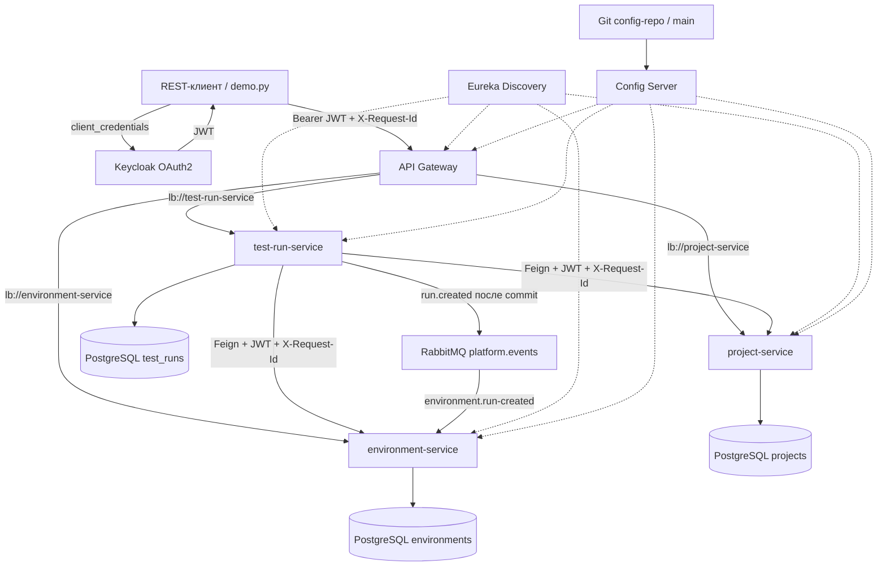

# Практическая работа № 8 — IaaS Test Platform

**Тема ВКР:** «Инфраструктура-как-сервис: автоматизированная платформа тестирования классического клиент-серверного ПО по ГОСТ Р 56939—2024».

Это первая итерация платформы на Java и Spring Cloud. Реализованы API регистрации ПО и шаблонов стендов, создание тестовых запусков с проверкой ссылок через Feign, управление состоянием запуска и приём результата со ссылкой на артефакт.

**Пока нет автоматического создания виртуальных машин и исполнения тестов.** Шаблон стенда описывает желаемую инфраструктуру. Перевод запуска в `RUNNING` и запись результата выполняются через API вручную. В следующих итерациях эти операции будет выполнять runner. Наличие записи `PASSED` само по себе не подтверждает соответствие ГОСТ.

## Схема архитектуры



При создании запуска один `X-Request-Id` проходит через Gateway, test-run-service и оба Feign-вызова. Он также включается в событие `run.created`; producer и consumer записывают одинаковые `requestId`, `eventId` и `runId` в журналы.

## С чего начать

1. Прочитать [разбор задания](docs/01-practice-requirements.md).
2. Посмотреть [концепцию ВКР](docs/02-thesis-concept.md) и [архитектуру](docs/03-architecture.md).
3. Запустить проект по инструкции ниже.
4. Продолжить по [плану разработки](docs/05-roadmap.md).

## Структура

| Каталог | Назначение |
| --- | --- |
| `project-service` | Тестируемое ПО, версия, ссылка на дистрибутив |
| `environment-service` | Шаблоны стендов: ОС, образ, CPU, RAM |
| `test-run-service` | Запуски, Feign-клиенты, состояния, результаты |
| `api-gateway` | Единая точка входа и балансировка через `lb://` |
| `discovery-server` | Реестр экземпляров Eureka |
| `config-server` | Spring Cloud Config с Git backend |
| `config-repo` | Исходные YAML-файлы конфигурации без паролей |
| `infra/keycloak` | OAuth2 realm и клиент для учебного API |
| `docs` | Требования, концепция, архитектура, ГОСТ, план |
| `report` | Итоговые DOCX/PDF, диаграммы, снимки проверок и исходные результаты |
| RabbitMQ | События `run.created` от test-run-service к environment-service |

## Запуск локального стенда

Нужны Docker Desktop с Docker Compose, Git, Python 3 для демонстрации. Для сборки без Docker нужен JDK 21 или новее. Проект компилируется с `release=21`; в текущей среде для проверки используется установленный JDK 23. Java 11 из системного `PATH` не подходит.

Из папки `ПиРКСП_№8`:

```bash
./run.sh
```

Скрипт создаёт `.env` из `.env.example`, подготавливает локальный Git-репозиторий конфигурации в `.runtime/config-repo` и поднимает контейнеры. Значения `.env.example` предназначены для локальной учебной демонстрации; перед внешним развёртыванием потребуются отдельные секреты и настройки доступа. Сервисы публикуются только на `127.0.0.1`.

При первом запуске Docker скачает образы и Maven-зависимости. Состав: шесть Java-приложений, Keycloak, RabbitMQ и **три отдельных контейнера PostgreSQL** — 11 контейнеров; при двух репликах project-service — 12. Для стенда желательно выделить Docker 6–8 ГБ RAM.

| Адрес | Назначение |
| --- | --- |
| http://localhost:8080 | REST API через Gateway |
| http://localhost:8180 | Keycloak, realm `test-platform` |
| http://localhost:15672 | RabbitMQ Management; логин `platform`, пароль из `.env` |
| http://localhost:8761 | Eureka, список экземпляров |
| http://localhost:8888/project-service/default/main | Конфигурация проекта из Git |

Веб-интерфейс платформы на этом этапе не создавался. Проверка выполняется через REST API.

Если порт 8080 занят, задайте в `.env` значение `GATEWAY_PORT=8088` и выполните `docker compose up -d`. API будет доступно на http://localhost:8088; `scripts/demo.py` автоматически использует порт из `.env`. Текущий адрес можно узнать командой `docker compose port api-gateway 8080`.

```bash
docker compose ps
docker compose logs --tail=100 api-gateway project-service environment-service test-run-service
./scripts/demo.py
```

Демонстрация получает OAuth2-токен через `client_credentials`, проверяет отказ без токена, создаёт проект и шаблон стенда, создаёт запуск, переводит его в `RUNNING` и записывает **учебный** результат. Это проверка взаимодействия API; настоящее тестирование дистрибутива не выполняется. JSON с ответами сохраняется в `.runtime/demo-result.json`, токен в файл не записывается.

Обновление конфигурации:

```bash
./scripts/prepare-config.sh
docker compose restart config-server
docker compose restart api-gateway project-service environment-service test-run-service
```

Изменять следует файлы `config-repo/*.yaml`. Скрипт фиксирует их копии в отдельном Git-репозитории; глобальная конфигурация Git не меняется. Горячее обновление через Bus/Refresh пока не реализовано.

Остановка с сохранением данных:

```bash
docker compose down
```

Keycloak импортирует realm при первом создании. Если realm уже существует, изменение JSON или `PLATFORM_CLIENT_SECRET` не меняет автоматически существующего клиента: обновите клиент в административном интерфейсе Keycloak. Не удаляйте тома с данными для обычного перезапуска.

## Сборка и тесты без Docker

```bash
# macOS: выбрать установленный JDK >= 21
export JAVA_HOME=$(/usr/libexec/java_home -v 23)
./mvnw -B verify
```

JUnit/Mockito проверяют сохранение сущностей, ошибки ссылок, передачу токена Feign-клиентам, недоступность зависимостей и переходы статусов. MVC-тесты проверяют 401 без токена, права чтения/записи и валидацию. Подключение к PostgreSQL и Keycloak для этих тестов не требуется. Они не заменяют интеграционную проверку всего стенда.

## Демонстрация балансировки

```bash
docker compose up -d --scale project-service=2
# Подождать регистрации двух экземпляров в Eureka
./scripts/demo.py --balance
```

Скрипт делает несколько GET-запросов через Gateway и выводит заголовок `X-Service-Instance`. Должны появиться два разных экземпляра. Две реплики одного микросервиса используют одну его БД; разные микросервисы имеют отдельные экземпляры БД.

## Материалы для сдачи

- [Отчёт DOCX](report/Отчёт_ПиРКСП_ПР8_Румянцев_АА_ИКБО-11-23.docx) и [PDF](report/Отчёт_ПиРКСП_ПР8_Румянцев_АА_ИКБО-11-23.pdf).
- [Пять этапов сквозного сценария](report/evidence/scenario.json), [контейнеры](report/evidence/containers.txt), [requestId через четыре сервиса](report/evidence/request-trace.txt), [обмен RabbitMQ](report/evidence/rabbitmq.txt), [отказ и восстановление](report/evidence/failure.json).
- [Скриншоты](report/screenshots) сделаны браузером по сохранённым фактическим HTTP-ответам и журналам. Это протокол проверки REST API; отдельного пользовательского веб-интерфейса платформа не имеет.
- Снимок завершения BootcampLabs студент прикладывает отдельно.

Повторное получение материалов (стенд должен работать):

```bash
./scripts/demo.py
# Временно останавливает environment-service и восстанавливает в finally:
python3 scripts/verify_submission.py --failure
# Для проверки двух реплик:
docker compose up -d --scale project-service=2
./scripts/demo.py --balance
python3 report/collect_evidence.py
python3 report/render_evidence.py
```

## События и поведение при отказе

`test-run-service` публикует `run.created` после успешного коммита записи запуска. Durable exchange `platform.events` маршрутизирует его в durable queue `environment.run-created`. `environment-service` получает JSON через `@RabbitListener` и пишет уведомление в журнал. Consumer пока выполняет только аудит уведомления; ВМ и тесты не запускает.

При недоступности project-service или environment-service создание запуска возвращает HTTP 503 и не сохраняет непроверенную запись. Независимые сервисы продолжают отвечать. После восстановления создание снова возвращает HTTP 201.

Доставка уведомлений в этой учебной версии не имеет transactional outbox: сбой брокера после коммита БД может привести к потере уведомления. Ошибка публикации попадает в журнал, уже сохранённая запись не откатывается; автоматического повтора нет. Эта реализация не заявляет exactly-once доставку.

## Статус практической

Код, конфигурация OAuth2, Git Config Server, Discovery, Gateway, Feign и Compose подготовлены. Результаты проверки текущей среды находятся в [verification.md](docs/verification.md). Развёртывание в Yandex/VK Cloud либо Minikube, остаётся отдельным этапом: Docker Compose не заменяет требование о развёртывании из методички.

Версии Spring Boot `3.5.16` и Spring Cloud `2025.0.3` зафиксированы для воспроизводимости и согласованы с существующими практическими. Совместимость веток `3.5.x`/`2025.0.x` указана в [матрице Spring Cloud](https://github.com/spring-cloud/spring-cloud-release/wiki/Supported-Versions).

Репозиторий: https://github.com/froid228/iaas-test-platform-pr8
