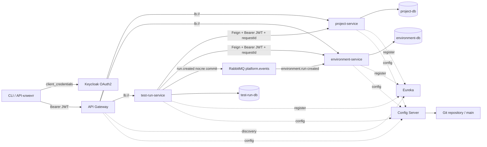
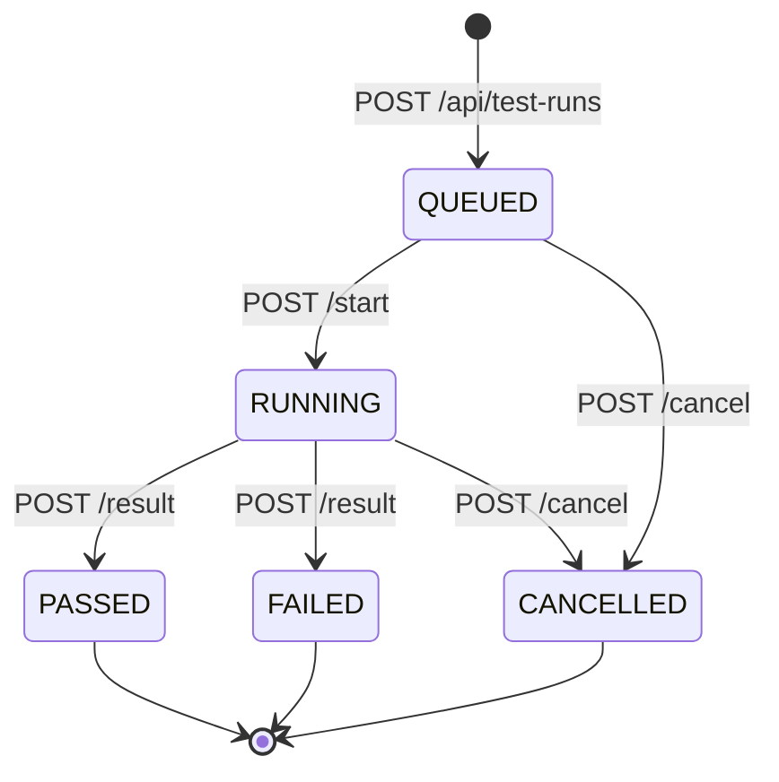

# Архитектура первой итерации

Каждый модуль собирается в отдельный исполняемый JAR. Доменная модель не вынесена в общую библиотеку: сервисы согласуют JSON-контракты, а не совместно используют JPA-сущности. DTO Feign содержит только необходимый идентификатор.

## Данные и API

| Сервис | Основные данные | Методы |
| --- | --- | --- |
| project-service | id, name, softwareVersion, artifactReference, createdAt | `POST/GET /api/projects`, `GET /api/projects/{id}` |
| environment-service | id, name, operatingSystem, imageReference, cpu, memoryMb | `POST/GET /api/environments`, `GET /api/environments/{id}` |
| test-run-service | id, projectId, environmentId, testSuite, requestedBy, status, время, summary, evidenceUri | `POST/GET /api/test-runs`, `GET /api/test-runs/{id}`, `POST .../{id}/start`, `POST .../{id}/result`, `POST .../{id}/cancel` |

UUID внешних сущностей в test-run-service — ссылки на API других сервисов, а не межбазовые внешние ключи. Удаление проектов и шаблонов в первой итерации отсутствует. Перед созданием запуска оба идентификатора проверяются через Feign. Запись в БД создаётся после успешных проверок; распределённой транзакции нет.

Для полноценной воспроизводимости runner должен сохранять снимок параметров стенда, хеш дистрибутива и версию набора тестов. Пока сохраняются идентификаторы и строковое имя набора, а изменение сущностей через API не реализовано.

## Жизненный цикл запуска

Терминальные состояния не перезаписываются. `@Version` предотвращает потерю параллельных обновлений сущности. Автоматической очереди и worker ещё нет; текущие методы служат контрактом будущего runner.

## Доступ и сетевые вызовы

Keycloak выдаёт токен сервисной учётной записи клиента `platform-cli` по OAuth2 `client_credentials`. Пользовательская форма входа и Authorization Code + PKCE пока отсутствуют. На Gateway и в каждом предметном сервисе проверяются JWT, issuer, audience `platform-api` и scope. Чтение требует `platform.read`, запись — `platform.write`. Стандартный учебный клиент получает оба scope.

Feign передаёт входной Bearer-токен в сервисы реестра и стендов. Поэтому для создания запуска нужны права записи и чтения. Secret клиента остаётся у вызывающего CLI и не передаётся предметным сервисам. Пароли БД берутся из окружения контейнеров.

В Docker внешний issuer `http://localhost:8180/realms/test-platform` одинаков для клиента и проверки токена. JWK получаются по внутреннему адресу `http://keycloak:8080/.../certs`. Так контейнерам не нужно обращаться к собственному `localhost` для загрузки ключей. Для Minikube/облака адреса потребуется адаптировать.

У Feign заданы connect/read timeout; отсутствующая ссылка даёт 422, ошибка прав зависимости — 403, недоступность — 503. У Gateway задан тайм-аут ответа. Circuit breaker и автоматические повторы POST пока не добавлены. Идемпотентность создания запуска — отдельная задача перед подключением автоматизации.

## Конфигурация и развёртывание

`config-repo` — редактируемые источники. `prepare-config.sh` копирует YAML в `.runtime/config-repo`, создаёт локальный Git-репозиторий с веткой `main` и коммитит изменения. Config Server использует Git backend с `file:` URI. Это настоящий Git-источник, а не профиль `native` с папкой YAML.

Миграции Flyway находятся внутри соответствующего сервиса, Hibernate проверяет схему (`ddl-auto=validate`). У каждого предметного сервиса свой контейнер PostgreSQL и том. Реплики одного сервиса разделяют его базу.

Eureka/Config доступны с хоста для учебной демонстрации. Настройка доступа к инфраструктурным API, TLS и внешняя БД Keycloak потребуются перед внешним размещением. Текущий `start-dev` Keycloak и loopback-порты рассчитаны на локальный стенд.

## Корреляция и события

Gateway формирует или принимает `X-Request-Id` (до 100 допустимых символов); сервисы возвращают его и пишут в логи. Feign RequestInterceptor передаёт его из MDC в downstream-запросы. Контекст очищается после обработки. Таким образом, один POST создания запуска связан с двумя проверочными GET по одному идентификатору.

После коммита создания запуска `@TransactionalEventListener` отправляет `run.created` в RabbitMQ. Durable exchange `platform.events` и durable queue `environment.run-created` объявляются Spring AMQP. JSON содержит `eventId`, `runId`, `environmentId`, `requestId`. Environment-service получает уведомление через `@RabbitListener` и пишет аудит в журнал. Это не runner и не механизм выделения виртуальных машин.

Между БД и брокером нет общей транзакции или outbox. При отказе публикации уведомление может потеряться; ошибка логируется, автоматический повтор не реализован. Сохранённая запись запуска остаётся доступна.

Настоящие результаты проверки сквозного requestId, доставки сообщения и остановки сервиса находятся в `report/evidence`. При недоступной Feign-зависимости запись не создаётся, клиент получает 503; после восстановления снова получается 201.
